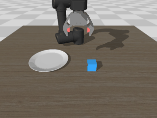
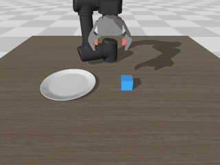
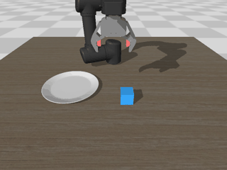

# Cube Pick-and-Place with Contact Detection

> 原项目地址：[https://github.com/jeongeun980906/lerobot-mujoco-tutorial](https://github.com/jeongeun980906/lerobot-mujoco-tutorial)

基于 ACT 模仿学习与 MuJoCo 仿真的 5cm 立方体抓取-放置任务。核心机制：

- **接触检测抓取判定**：≥2 个夹爪/软垫 geom 与立方体接触才算夹住
- **自适应闭合**：闭合命令从 0.5 逐步逼近，接触触发后 +0.15 夹紧，避免过压挤飞或欠压滑脱
- **三条件放置判定**：立方体中心在盘半径内 + 接触盘面且静止 + 与夹爪零接触
- **闭环**：FSM 自动采集 → ACT 训练 → 部署评测，另有 DAgger 接管数据机制

---

## 一、环境准备

- Python 3.10，conda 环境
- 核心依赖：`mujoco`、`torch`、`lerobot`、`torchvision`、`numpy`、`Pillow`，完整清单见 [requirements.txt](./requirements.txt)

```bash
conda activate your_env
pip install -r requirements.txt      # 在项目根目录执行一次即可
cd ~/cube_pick_and_place/cube_pnp    # 所有脚本均在 cube_pnp/ 下运行
```

**目录约束**：所有脚本通过父目录 import `mujoco_env`，`cube_pnp/` 与 `mujoco_env/` 位于同一项目根目录下，整体搬迁时须保持二者的相对位置不变；`asset/` 内 include 均为相对路径，必须整体搬迁。

## 二、目录结构

```
cube_pick_and_place/
├── cube_pnp/                       # 任务脚本、模型资产与数据
│   ├── asset/                      # 自包含模型资产（95MB，已纳入 git）
│   │   ├── example_scene_cube.xml  # 场景定义
│   │   ├── robotis_omy/omy_cube.xml# 含软垫的机械臂模型
│   │   ├── objaverse/cube_5cm/     # 5cm 立方体模型
│   │   ├── objaverse/plate_11/     # 盘子模型
│   │   └── tabletop/               # 桌面
│   ├── cube_collect_data.py        # FSM 自动数据采集
│   ├── cube_train.py               # ACT 训练（chunk_size=20，双视角，支持微调）
│   ├── cube_deploy.py              # 闭环评测（成功率 + 失败分类）
│   ├── cube_dagger_collect.py      # DAgger 接管数据采集
│   └── cube_visualize.py           # 数据可视化 / 回放 / 统计
├── mujoco_env/                     # MuJoCo 环境封装（cube_pnp 脚本通过父目录 import）
│   ├── y_env.py                    # SimpleEnv（盘子固定位置 PLATE_FIXED_XYZ）
│   ├── y_env2.py
│   ├── ik.py                       # 逆运动学求解
│   ├── mujoco_parser.py
│   ├── transforms.py               # 位姿变换（rpy2r / r2rpy）
│   └── utils.py
├── README.md                       # 本文件（项目级说明）
└── requirements.txt                # 依赖清单
```

数据集（`demo_data_*`、`data104`）、checkpoint（`ckpt/`）、实验记录（`todolist.md`）等本地生成物未列入（见 `.gitignore`）。

## 三、布局控制机制（先读这节）

**盘子已固定在环境层**（`mujoco_env/y_env.py` 的 `PLATE_FIXED_XYZ = (0.254, -0.192, 0.82)`），对所有脚本生效，不再随机。

**立方体位置由两个参数控制**：

| 参数 | 效果 |
|---|---|
| `--seed 0` | 固定位置（环境内部对任何非负 seed 都重置为 0，位置完全确定且每回合相同） |
| `--seed -1` | 每回合在 x∈[0.24,0.4]、y∈[-0.2,0.2] 内随机采样 |
| `--cube_jitter J` | 在 reset 位置基础上每回合加 ±J 的 x/y 均匀扰动（采集与部署脚本均支持） |

三个 demo 正是这三种布局配置的组合。

---

## 四、操作流程（三个 Demo）

### Demo 1：固定盘子 + 固定立方体（单一布局）

> 目的：验证「采集 → 训练 → 部署」管线正确性，观察策略对单一轨迹的复现能力。

**1. 采集**（30 集，全部同一布局）：

```bash
python cube_collect_data.py --num_demo 30 --seed 0 \
    --root ./demo_data_fixed --delete-old
```

**2. 训练**：

```bash
python cube_train.py --root ./demo_data_fixed --steps 1500 \
    --ckpt ./ckpt/act_cube_fixed
```

**3. 评测**（`--seed 0` 与训练布局一致，`--n_action_steps 10` 执行半个 chunk）：

```bash
python cube_deploy.py --eval 10 --seed 0 --n_action_steps 10 \
    --ckpt ./ckpt/act_cube_fixed --root ./demo_data_fixed
```

**预期与解读**：成功率通常接近 100%，但这是**记忆重放**而非泛化——评测 10 回合测的是同一个布局。换 `--seed -1` 立即失效属正常现象。

**实测结果**（用已有的 seed-0 单一布局模型 `ckpt/data104` 验证，与上方 `act_cube_fixed` 训练流程产出的模型预期表现一致）：

```bash
python cube_deploy.py --eval 10 --seed 0 --n_action_steps 10 \
    --ckpt ./ckpt/data104 --root ./data104
```

```
EVAL RESULT: 10/10 success = 100.0%
[eval 1/10] SUCCESS at step=155, cube=(0.281,-0.225,0.833)
[eval 2/10] SUCCESS at step=155, cube=(0.279,-0.218,0.833)
[eval 3/10] SUCCESS at step=154, cube=(0.270,-0.212,0.833)
...（10/10，每回合约 155 步完成，立方体均落在固定盘位 (0.28,-0.22) 附近）
```


---

### Demo 2：固定盘子 + 立方体微小变化（局部鲁棒性）

> 目的：在固定任务周围引入连续的小变化，让模型学到「立方体位置 → 轨迹」的对应关系，扩大吸引域。

**1. 采集**（30 集，固定名义位置 + 每回合 ±2cm 扰动）：

```bash
python cube_collect_data.py --num_demo 30 --seed 0 --cube_jitter 0.02 \
    --root ./demo_data_jitter --delete-old
```

**2. 训练**：

```bash
python cube_train.py --root ./demo_data_jitter --steps 1500 \
    --ckpt ./ckpt/act_cube_jitter
```

**3. 评测**（`--cube_jitter 0.02` 与训练分布一致）：

```bash
python cube_deploy.py --eval 10 --seed 0 --cube_jitter 0.02 \
    --n_action_steps 10 \
    --ckpt ./ckpt/act_cube_jitter --root ./demo_data_jitter
```

**可选**：评测时加大 `--cube_jitter 0.03` 测试分布外容忍度。

**预期与解读**：成功率略低于 Demo 1 但仍应显著高于随机布局模型；此数据分布是「精确性」与「鲁棒性」的折中。

**实测结果**（用已有模型 `ckpt/demo_data_dart` 验证，其训练数据与上方 `act_cube_jitter` 流程同属「固定名义 + 立方体扰动」分布）：

```bash
python cube_deploy.py --eval 10 --seed 0 --n_action_steps 10 \
    --ckpt ./ckpt/demo_data_dart --root ./demo_data_dart \
    --cube_jitter 0.02
```

```
EVAL RESULT: 9/10 success = 90.0%
failure breakdown:
  GRASP_FAIL       1  (100% of failures, 10% of all)
[eval 1/10] SUCCESS at step=165, cube=(0.259,-0.195,0.833)
[eval 2/10] SUCCESS at step=163, cube=(0.250,-0.203,0.833)
...（9/10 成功，立方体均落在盘位附近；唯一失败为扰动到 (0.403,0.156) 角落位置的
GRASP_FAIL——偏离名义位置最远时抓取仍会失效，符合局部鲁棒性预期）
```



---

### Demo 3：固定盘子 + 立方体随机（真实泛化验收）

> 目的：随机布局下的成功率是**唯一验收口径**（历史上 val loss 0.060 的模型直播仅 2%）。

**1. 采集**（30 集随机布局）：

```bash
python cube_collect_data.py --num_demo 30 --seed -1 \
    --root ./demo_data_random --delete-old
```

**2. 训练**：

```bash
python cube_train.py --root ./demo_data_random --steps 1500 \
    --ckpt ./ckpt/act_cube_random
```

**3. 评测**（`--seed -1` 随机布局，与训练分布一致）：

```bash
python cube_deploy.py --eval 10 --seed -1 --n_action_steps 10 \
    --ckpt ./ckpt/act_cube_random --root ./demo_data_random
```

评测输出含成功率与失败分类（GRASP_FAIL / DROPPED / PLACE_OFFSET / NOT_RELEASED / TIMEOUT_OTHER），失败分布是下一轮优化的依据。

**实测结果**（用已有模型 `ckpt/demo_data_fixplate` 验证，其训练数据与上方 `act_cube_random` 流程同属「固定盘子 + 随机立方体」分布）：

```bash
python cube_deploy.py --eval 10 --seed -1 --n_action_steps 10 \
    --ckpt ./ckpt/demo_data_fixplate --root ./demo_data_fixplate
```

```
EVAL RESULT: 4/10 success = 40.0%
failure breakdown:
  GRASP_FAIL       6  (100% of failures, 60% of all)
[eval 3/10] SUCCESS at step=147, cube=(0.260,-0.191,0.833)
[eval 4/10] SUCCESS at step=145, cube=(0.257,-0.191,0.833)
...（4/10 成功；失败全部为 GRASP_FAIL（夹空、从未抬起），放置/搬运零失败。
对比历史基线：盘/立方体双随机 + 单视角 + chunk 10 的 act_cube 仅 2%，
固定盘子（配合双视角/chunk 20）后达 40%——盘子位置方差是泛化困难的重要来源，
抓取阶段仍是主要瓶颈，与历史结论一致）
```



---

## 五、进阶：DAgger 接管数据

策略直播偏离（夹空/掉落/超时）后由 FSM 从当前状态接管完成剩余任务，整段「策略 + 恢复」轨迹追加进数据集。采集时自动用无状态专家重标注策略阶段帧（`--relabel` 默认开启）。

```bash
# 1. 采集接管数据（追加到已有数据集，不覆盖）
python cube_dagger_collect.py --num_demo 30 --ckpt ./ckpt/act_cube_random \
    --root ./demo_data_random --stats_root ./demo_data_random

# 2. 微调续训（DAgger 迭代的标准做法：合并数据 + 小学习率）
python cube_train.py --init_from ./ckpt/act_cube_random \
    --root ./demo_data_random --steps 1500 --lr 5e-5 \
    --ckpt ./ckpt/act_cube_dagger2

# 3. 评测
python cube_deploy.py --eval 10 --seed -1 --n_action_steps 10 \
    --ckpt ./ckpt/act_cube_dagger2 --root ./demo_data_random
```

**实测结果**（`ckpt/fixplate_dagger`：demo_data_fixplate 数据 + DAgger 接管数据微调；对比未加 DAgger 的 `demo_data_fixplate` 模型 40%）：

```bash
python cube_deploy.py --eval 10 --seed -1 --n_action_steps 10 \
    --ckpt ./ckpt/fixplate_dagger --root ./demo_data_fixplate
```

```
EVAL RESULT: 6/10 success = 60.0%
failure breakdown:
  GRASP_FAIL       2  (50% of failures, 20% of all)
  PLACE_OFFSET     1  (25% of failures, 10% of all)
  TIMEOUT_OTHER    1  (25% of failures, 10% of all)
[eval 1/10] SUCCESS at step=170, cube=(0.250,-0.205,0.833)
...（6/10 成功；DAgger 恢复数据将随机布局成功率从 40% 提升至 60%，
抓取阶段（GRASP_FAIL）仍为主要瓶颈）
```



---

## 六、脚本参数速查

### cube_collect_data.py

| 参数 | 默认 | 说明 |
|---|---|---|
| `--num_demo` | 30 | 成功采集的 episode 数 |
| `--seed` | 0 | 负数为随机布局，固定值为固定布局 |
| `--root` | `./demo_data` | 数据集目录（已存在则追加续写） |
| `--cube_jitter` | 0 | 立方体每回合 ±J 的 x/y 扰动（m） |
| `--delete-old` | — | root 已存在时删除重建 |

### cube_train.py

| 参数 | 默认 | 说明 |
|---|---|---|
| `--root` | `./demo_data` | 数据集目录 |
| `--ckpt` | `./ckpt/act_cube` | 模型保存目录 |
| `--steps` | 1500 | 训练步数（1 步 = 1 个 batch） |
| `--batch_size` | 64 | 批量大小 |
| `--lr` | 1e-4 | 学习率（微调建议 5e-5） |
| `--init_from` | — | 从已有 ckpt 加载权重微调；归一化统计自动用当前数据集 |
| `--smooth_lambda` | 0 | 动作平滑损失权重（抖动严重时 0.05~0.2） |

固定配置：chunk_size=20、双视角（agentview + wrist）、全部 episode 参与训练。

**训练硬件与耗时**：NVIDIA GeForce RTX 4060 Laptop GPU（8GB 显存）。当前配置（batch 64、chunk_size 20、双视角、1500 步）单次训练耗时约 20 分钟以内。

### cube_deploy.py

| 参数 | 默认 | 说明 |
|---|---|---|
| `--eval` | 10 | 评测回合数（成败均计数） |
| `--seed` | 0 | 负数为随机布局 |
| `--ckpt` | `./ckpt/act_cube` | checkpoint（chunk_size 自动从 ckpt 读取） |
| `--root` | `./demo_data` | 归一化统计量来源，须与训练数据集一致 |
| `--n_action_steps` | 1 | K=1 用 temporal ensemble；K>1 每 K 步执行预测序列前 K 步（chunk 20 时 K=10 即执行一半） |
| `--cube_jitter` | 0 | 评测布局扰动，应与训练时采集配置一致 |
| `--log_actions` | — | 成功回合动作逐帧记录到 CSV |

### cube_visualize.py

```bash
python cube_visualize.py --root ./demo_data_random --stats          # 数据集统计
python cube_visualize.py --root ./demo_data_random --plot 0         # 帧图像与关节曲线
python cube_visualize.py --root ./demo_data_random --replay 5       # GT 开环回放验证
python cube_visualize.py --root ./demo_data_random --episode 3      # viewer 回放
```
